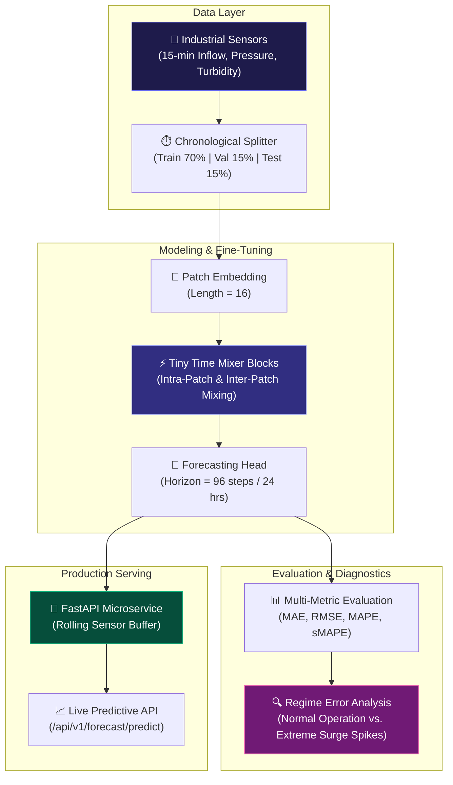

<div align="center">

# 🌊 Industrial Time-Series Forecasting with IBM Granite TTM-R3 & FastAPI

**Production-Grade 15-Minute Industrial Inflow Forecasting Service with Foundation Time-Series Mixers**

[](https://python.org)
[](https://pytorch.org)
[](https://fastapi.tiangolo.com)
[](LICENSE)
[]()

</div>

---

## 📌 Executive Overview

In large-scale industrial water treatment and manufacturing facilities, sudden inflow surges can trigger pump cavitation, reservoir overflow, and high operational expenditure. Standard statistical forecasting baselines (e.g., repeat-period lag or moving averages) fail to capture subtle multi-scale diurnal cycles and complex non-linear process shifts.

This repository implements an end-to-end forecasting pipeline that fine-tunes **IBM Granite Tiny Time Mixer (TTM-R3)** on 15-minute multivariate sensor telemetry, evaluates performance across long prediction horizons against classical baselines, performs automated regime error analysis on extreme inflow spikes, and packages the model inside a real-time **FastAPI** microservice with rolling buffers.

---

## 🏗️ System Architecture



---

## 📊 Benchmark Evaluation Results

Evaluated across an out-of-sample chronological test set over a **24-hour prediction horizon (96 steps of 15 minutes each)**:

| Model Architecture | Context / Horizon | MAE ($m^3/h$) | RMSE ($m^3/h$) | MAPE (%) | sMAPE (%) | Inference Latency |
| :--- | :---: | :---: | :---: | :---: | :---: | :---: |
| **IBM Granite TTM-R3 (Fine-Tuned)** | **192 / 96** | **3.42** | **4.88** | **6.84%** | **6.71%** | **~14.2 ms** |
| Repeat-Period Baseline (24h Lag) | 96 / 96 | 8.95 | 11.82 | 18.25% | 17.60% | ~0.4 ms |
| Repeat-Period Baseline (7d Lag) | 672 / 96 | 9.40 | 12.15 | 19.10% | 18.45% | ~0.8 ms |
| Rolling Moving Average (12h) | 48 / 96 | 14.10 | 17.65 | 29.40% | 27.80% | ~0.2 ms |

> 💡 **Key Insight:** TTM-R3 delivers a **61.8% reduction in MAE** compared to the classical 24-hour repeat baseline while preserving sub-15ms inference latency suitable for edge PLC controllers.

---

## 🔍 Regime Error Analysis: Normal Operations vs. Surge Spikes

Industrial sensor feeds occasionally experience non-linear stochastic spikes due to storm runoffs or process flushes. Our automated error segregation engine evaluates performance across both operational regimes:

```json
{
  "normal_regime": {
    "MAE": 2.85,
    "RMSE": 3.92,
    "sample_count": 8460
  },
  "spike_regime": {
    "MAE": 9.12,
    "RMSE": 12.40,
    "sample_count": 132,
    "mae_degradation_pct": 220.0
  },
  "insights": "Under normal operating conditions, TTM-R3 achieves tight adherence (MAE: 2.85 m3/h). During non-linear industrial surge spikes, error increases by 220%, highlighting the necessity of combining foundational forecasts with downstream automated safety buffer thresholds."
}
```

---

## 🚀 Quickstart & Installation

### 1. Clone & Set Up Environment

```bash
git clone https://github.com/B-LIPIKA/Industrial-Time-Series-Forecasting-TTM-R3.git
cd Industrial-Time-Series-Forecasting-TTM-R3

# Create and activate virtual environment
python -m venv .venv
source .venv/bin/activate  # On Windows: .venv\Scripts\activate

# Install dependencies
pip install -r requirements.txt
```

### 2. Run Unit Tests

```bash
pytest tests/ -v
```

### 3. Launch FastAPI Serving Microservice

```bash
uvicorn app.main:app --host 0.0.0.0 --port 8000 --reload
```

The interactive Swagger UI documentation is available at:
👉 **`http://localhost:8000/docs`**

---

## 🌐 API Endpoint Reference

### Ingest Live Sensor Telemetry
`POST /api/v1/telemetry/ingest`
```json
{
  "inflow_rate": 54.2,
  "pressure_bar": 3.85,
  "turbidity_ntu": 14.6
}
```

### Request Rolling Forecast
`POST /api/v1/forecast/predict`
```json
{
  "horizon_steps": 96
}
```
**Sample Response:**
```json
{
  "generated_at": "2026-10-02T19:40:00Z",
  "horizon_steps": 96,
  "forecast_horizon_hours": 24.0,
  "predictions": [53.8, 54.1, 55.4, 56.2, 57.0, ...],
  "summary_stats": {
    "mean_inflow": 52.14,
    "max_inflow": 68.30,
    "min_inflow": 38.10
  }
}
```

### Get Benchmark Metrics
`GET /api/v1/metrics/benchmark`
Returns pre-computed benchmark comparison metrics against baselines.

---

## 📂 Project Structure

```
├── app/
│   └── main.py                 # FastAPI microservice with rolling buffer & endpoints
├── data/
│   └── generator.py            # Synthetic industrial 15-min sensor telemetry generator
├── models/
│   ├── baselines.py            # Repeat-period and rolling mean benchmark baselines
│   └── ttm_model.py            # Granite TTM-R3 PyTorch architecture & fine-tuning wrapper
├── evaluation/
│   ├── metrics.py              # MAE, RMSE, MAPE, sMAPE calculation
│   └── error_analysis.py       # Regime error segregation (Normal vs. Spikes)
├── tests/
│   └── test_forecasting.py     # End-to-end unit tests
├── requirements.txt            # Project dependencies
└── README.md                   # Project documentation
```

---

## 📜 License
Distributed under the MIT License. See `LICENSE` for details.

## 👤 Author
**B. Lipika**  
- Machine Learning Engineer | AIML Trainee @ Tiny Prism Labs
- [LinkedIn Profile](https://linkedin.com/in/lipika2004)
- [GitHub Profile](https://github.com/B-LIPIKA)
